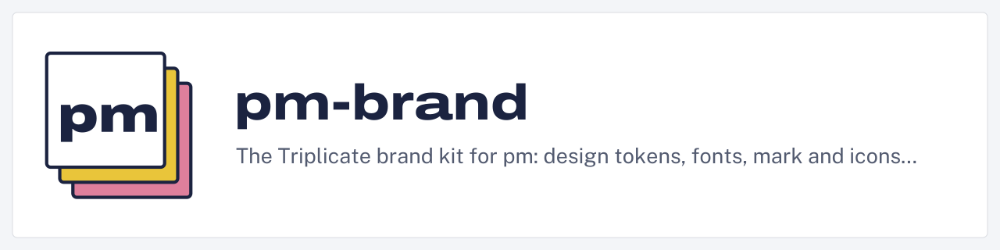
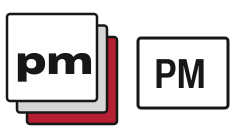
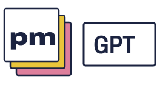
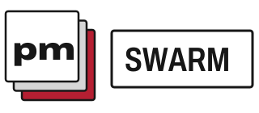

# pm-brand · Triplicate

<picture>
  <source media="(prefers-color-scheme: dark)" srcset="banners/pm-brand-dark.svg">
  
</picture>

Context management for any agent and any task or workflow. Project management
is context management for agents.

One shared identity for pm-cli.unbrained.dev, pm-web, pm-gpt, pm-mcp and pm-search:
cool form paper, carbon-blue ink, canary and rose copies, and violet stamp ink.
[CONTRACT.md](CONTRACT.md) defines the visual grammar and every public token.

**Before the first npm release, depend on an exact commit.**

```json
{ "dependencies": { "pm-brand": "github:unbraind/pm-brand#<40-character-commit>" } }
```

Compiled modules are tracked so exact-commit Git dependencies work when Bun blocks
dependency preparation. CI verifies them against a clean build.

<picture>
  <source media="(prefers-color-scheme: dark)" srcset="logo/mark-dark.svg">
  
</picture>

## Install and release approval

The first npm release is pending the maintainer's interactive bootstrap. After
that first publish, the maintainer configures npm trusted publishing for
`release.yml` and sets the repository variable `PM_RELEASE_APPROVED` to `true`.
The daily workflow and manual dispatch both require this variable and `main`.
Publishing uses OIDC with provenance and the explicit `latest` dist-tag; no stored
npm token is needed. Same-day collision versions such as `2026.10.27-1` remain
the newest daily release on `latest`.

After the first release, install the library and its CSS/assets with either:

```sh
npm install pm-brand
bun add pm-brand
```

This is an asset and SDK library with documented subpath exports and a standalone
`pm-brand diagnose` and `pm-brand font-coverage` commands. A pm integration imports
its exports directly. npm and Bun install the pm SDK peer for report accounting.
Before the first npm release, the exact-commit Git dependency below remains
available. Daily releases version the verified artifact automatically when main
changes; unchanged tagged source skips publication.

## CSS

```css
@import "pm-brand/tokens.css";
@import "pm-brand/fonts.css";

body {
  background: var(--pm-paper);
  color: var(--pm-carbon);
  font-family: var(--pm-font-body);
}
h1 {
  font-family: var(--pm-font-display);
  font-stretch: 125%;
  font-weight: 800;
}
```

Set `data-theme="light"` or `data-theme="dark"` on the root for an explicit
choice. Otherwise `prefers-color-scheme` applies. Reduced motion sets `--pm-dur`
to zero. Focus uses `--pm-focus` with `--pm-focus-offset` on interactive elements.

## Palette

| Token suffix | Light | Dark | Role |
|---|---|---|---|
| paper | #F3F5F8 | #0F1528 | Page |
| sheet | #FFFFFF | #171F37 | Items, panels, forms |
| carbon | #1B2340 | #E7EAF3 | Text, outlines |
| graphite | #535B70 | #A2A9BD | Secondary text |
| rule | rgba(27,35,64,.14) | rgba(231,234,243,.14) | Hairlines |
| canary | #E9C53A | #D7B53A | In progress, second copy |
| canary-wash | #FBF1C6 | #3A331C | In-progress chip fill |
| rose | #DE7F9C | #D07E97 | Blocked, third copy |
| rose-wash | #F9DDE5 | #3D2432 | Blocked chip fill |
| stamp | #5B3FC4 | #A894FF | Actions, links, focus, closed |
| stamp-wash | #ECE7FB | #2A2450 | Selection and hover |
| on-stamp | #FFFFFF | #0F1528 | Text on stamp |
| danger | #B42E3A | #F07A84 | Errors and destructive actions |

Status tokens are `--pm-status-<open|in_progress|blocked|closed|canceled>-<fg|bg|border>`.
The label text carries state and meets 4.5:1 in both themes. Chip borders are
decorative; canary, rose and rule stay unchanged. [All 68 measured comparisons](docs/contrast.md)
classify decorative borders separately and enforce text and focus thresholds.

## Rendered accessibility fault locations

Diagnose resolved consumer component roles with `diagnoseAccessibility` from
`pm-brand/accessibility`, or run:

```sh
pm-brand diagnose examples/accessibility.json --format toon --budget 1600
```

Every failure retains its component locator, theme, token references, resolved
foreground/background colours and measured ratio. Text, focus and decoration
use separate rules. JSON/TOON reports use the pm SDK's canonical budget accounting;
an insufficient budget returns a typed refusal with full failure counts and a
remedy. [Input contract and SDK example](docs/accessibility.md),
[runnable fixture](examples/accessibility.json).

## Font coverage preflight

Check proposed UI and banner labels before the shipped outline renderer turns
missing glyphs into `?`. `preflightFontCoverage` returns selected fonts, every
unsupported code point and the strings needing explicit replacement. A batch
accepts 100 labels and returns only failures by default.

```sh
pm-brand font-coverage examples/font-coverage.json --format toon --budget 1600
```

Use `preflightFontCoverage` or `renderFontCoverageReport` from `pm-brand` or
`pm-brand/font-coverage`. See [the schema and SDK example](docs/font-coverage.md)
for code point accounting, fallback routes and typed refusal remedies. This
checks shipped outline coverage; browser fallback and shaping require separate
validation.

## Without git

Token, contrast, component and font diagnostics, report rendering, CLI and image APIs work
in plain directories. They need no git repository or tracker. Repository release
and build-parity maintenance scripts require a checkout.

## Type

| Role | Family | Setting |
|---|---|---|
| Display | Archivo | 125% width, weight 800; mark weight 900 |
| Caption | Archivo | 75% width, weight 600, uppercase, .09em tracking |
| Body | Public Sans | Weights 400–700 |
| Data | Martian Mono | Weights 400–700, widths 75–112.5% |

Self-hosted normal Latin WOFF2 files use `font-display: swap` and relative URLs.
Fallback overrides are calculated from shipped font metrics and pinned measured
Arial/Courier New metrics. No Google Fonts or third-party CDN requests are needed.
Every requested encoded character available upstream is retained; optional
unencoded alternates/ligatures are omitted. [Exact sources and metrics](fonts/SOURCES.md).

| Font | Bytes |
|---|---:|
| Archivo | 71,544 |
| Public Sans | 20,756 |
| Martian Mono | 24,252 |
| **Total / maximum** | **116,552 / 120,000** |

Code is MIT; fonts and their derived outline data are SIL OFL 1.1. Each family's
copyright and complete licence are bundled in [fonts/OFL.txt](fonts/OFL.txt).

## TypeScript

```ts
import { tokens, cssVar } from 'pm-brand';

const paper = tokens.light.paper;              // #F3F5F8
const body = tokens.dark['font-body'];         // complete font stack
const outline = cssVar('status-open-border'); // var(--pm-status-open-border)
const focus = cssVar('--pm-focus');
```

`tokens.light` and `tokens.dark` contain every contract suffix, including colour,
status, font, scale, radius, focus and motion tokens. Reference-valued tokens
remain CSS references. `cssVar` accepts only known suffixes or full `--pm-` names.
A parity test parses the independent stylesheet in both dark selectors and light
mode; changing one side alone fails the gate.

## README banners and Open Graph cards

```ts
import { writeFile } from 'node:fs/promises';
import { banner } from 'pm-brand/banner';
import { ogImage, renderPng } from 'pm-brand/og';

await writeFile('banner.svg', banner({
  name: 'pm-web', tagline: 'Keep every agent on the same page.', theme: 'light',
}));
await writeFile('og.png', renderPng(ogImage({
  title: 'Context for any agent and task', eyebrow: 'Context management',
  product: 'pm-web', theme: 'dark',
})));
```

Banners are 1280×320; OG cards are 1200×630. The generators use pinned Archivo
and Public Sans glyph paths, so their SVGs need no external font or platform text
renderer. Names and taglines ellipsize; OG titles wrap to at most three measured
lines. XML syntax is escaped, controls are rejected, and unsupported characters
render as a question mark while accessible metadata retains the bounded text.

Every text field (`name`, `tagline`, `title`, `eyebrow`, `product`) is capped at
512 Unicode code points before validation, measurement, or metadata generation.
Only complete graphemes are retained: a combining sequence or emoji ZWJ sequence
crossing the cap is dropped in full. The cap reads at most 513 code points,
including boundary lookahead, even for a single enormous combining sequence.
Discarded content is neither rendered nor validated. Uppercase OG labels are
capped again after conversion. Width truncation uses cumulative glyph advances
in linear time and adds an ellipsis only at a complete grapheme boundary.

`pm-brand/banner` works without native dependencies. `pm-brand/og` and its
`renderPng` require the optional peer `@resvg/resvg-js` (`npm install @resvg/resvg-js`).
The root token export never imports the native renderer and is suitable for web
bundlers. Rendering helpers are intended for build tools and server environments.

## Committed package banner set

Banner titles use bare `pm-<name>` branding: npm scopes are stripped for display,
while the catalog retains scoped names for package identity and install commands.
The [description audit](docs/package-description-audit.md) records package-owned follow-ups.

The [reviewed catalog](banners/packages.json) captures the exact npm name and real
one-line `package.json` description for all 26 public fleet packages except
pm-cli, including pm-brand. Scoped packages use their repository basename as the
filename: `@unbrained/pm-web` is `banners/pm-web.svg`.

`npm run banners:build` generates 52 deterministic SVGs: `<repo>.svg` for light
and `<repo>-dark.svg` for dark. `npm run banners:check`, included in both release
gates, rejects changed, missing or surplus generated assets. Update the catalog
from the reviewed public fleet manifests, regenerate, then commit both together.
No sibling checkouts or network access are needed to check a catalog snapshot.

Use an immutable pm-brand **commit**, with a fixed theme selected by `<picture>`:

```html
<picture>
  <source media="(prefers-color-scheme: dark)"
    srcset="https://raw.githubusercontent.com/unbraind/pm-brand/COMMIT/banners/pm-graph-dark.svg">
  
</picture>
```

Replace `COMMIT` with the reviewed 40-character SHA. These assets are owned and
committed here; consumer repositories embed them and never copy them.

SVG is the chosen embed format. We compared path-based SVG with 1280×320 PNG on
GitHub's light and dark backgrounds at 1440, 768 and 390 px, at 1× and 2× pixel
ratios. Both render correctly; SVG preserves crisp outlines at every scale and
avoids doubling the raster payload for 2× displays. Fixed variants avoid relying
on GitHub's image proxy to evaluate an SVG media query. Paths require no font
request, CSS import, script or foreign object. Long descriptions ellipsize on the
visible line; the exact full description remains in accessible metadata.
The before/after gallery uses the existing generator and committed output with
the same public catalog, so the intended appearance remains identical.

## Exports and assets

| Export | Contents |
|---|---|
| `pm-brand` | `tokens`, `cssVar`, `Theme`, `TokenName`, `diagnoseAccessibility`, `preflightFontCoverage`, `renderFontCoverageReport` and diagnostic types |
| `pm-brand/banner` | `banner`, `BannerOptions` |
| `pm-brand/og` | `ogImage`, `renderPng`, `OgOptions` |
| `pm-brand/contrast` | WCAG colour parsing, luminance, contrast and complete audit |
| `pm-brand/accessibility` | Strict consumer request schema, typed diagnostics and complete fault locations |
| `pm-brand/accessibility-report` | Budgeted TOON/JSON reports, lazy public SDK acquisition and host injection |
| `pm-brand/font-coverage` | Strict font coverage schema, exact renderer routes and budgeted reports |
| `pm-brand/tokens.css` | All custom properties and theme/motion selectors |
| `pm-brand/fonts.css` | Brand faces and measured fallback faces |
| `pm-brand/fonts/*` | Three WOFF2 subsets, OFL licences, source receipts |
| `pm-brand/logo/*` | Adaptive, fixed light/dark and currentColor marks; wordmark and mark-caption lockups |
| `pm-brand/icons/*` | SVG favicon; 32, 180, 192, 512 PNGs and maskable 512 PNG |
| `pm-brand/CONTRACT.md` | Shared visual contract |
| `pm-brand/package.json` | Package metadata |

All mark lettering is Archivo width 125 / weight 900 as paths; condensed lockup
captions are also paths. A single TypeScript generator owns the geometry. The
maskable icon keeps its foreground inside the central safe circle.


## Mark and wordmark lockups

The compact mark family uses the three sheets followed by one product caption;
the wordmark family keeps the original `pm` lettering. Caption boxes are transparent.
Inline ink uses `currentColor` and adaptive SVGs read the surface's `--pm-carbon`
and `--pm-sheet`. Standalone `` SVGs follow `prefers-color-scheme` through
embedded CSS. Use fixed `*-light.svg` / `*-dark.svg` variants for OG renderers or
GitHub `<picture>` sources that cannot evaluate SVG media queries. The monochrome
mark inherits `color` directly and works on either theme.

| Product | Wordmark | Compact mark + caption |
|---|---|---|
| PM | <picture><source media="(prefers-color-scheme: dark)" srcset="logo/lockup-pm-dark.svg"></picture> | <picture><source media="(prefers-color-scheme: dark)" srcset="logo/lockup-mark-pm-dark.svg"></picture> |
| WEB | <picture><source media="(prefers-color-scheme: dark)" srcset="logo/lockup-web-dark.svg"></picture> | <picture><source media="(prefers-color-scheme: dark)" srcset="logo/lockup-mark-web-dark.svg"></picture> |
| GPT | <picture><source media="(prefers-color-scheme: dark)" srcset="logo/lockup-gpt-dark.svg"></picture> | <picture><source media="(prefers-color-scheme: dark)" srcset="logo/lockup-mark-gpt-dark.svg"></picture> |
| MCP | <picture><source media="(prefers-color-scheme: dark)" srcset="logo/lockup-mcp-dark.svg"></picture> | <picture><source media="(prefers-color-scheme: dark)" srcset="logo/lockup-mark-mcp-dark.svg"></picture> |
| SEARCH | <picture><source media="(prefers-color-scheme: dark)" srcset="logo/lockup-search-dark.svg"></picture> | <picture><source media="(prefers-color-scheme: dark)" srcset="logo/lockup-mark-search-dark.svg"></picture> |
| SWARM | <picture><source media="(prefers-color-scheme: dark)" srcset="logo/lockup-swarm-dark.svg"></picture> | <picture><source media="(prefers-color-scheme: dark)" srcset="logo/lockup-mark-swarm-dark.svg"></picture> |

## Semantic asset change reports

Compare generated SVGs with `compareSemanticAssets` or
`pm-brand semantic-diff examples/semantic-assets.json --format toon`. Findings
locate changed visible text, token roles, geometry and accessible labels while
ignoring attribute order and XML spelling noise. The example produces two changes:
one status color and one truncated label. JSON and TOON use the pm SDK's output
budget accounting and retain complete counts on refusal. No raster generation,
network or tracker writes are needed. See [the SDK example and supported static SVG
grammar](docs/semantic-assets.md).

XML syntax uses the maintained `@rgrove/parse-xml` parser. Equivalent escaping,
CDATA, namespace prefixes, comments and inert processing instructions produce no
findings. Malformed XML/limits return `unsupported_svg`; well-formed constructs
outside the comparison subset return `unsupported_semantics`, both with remedies.
Empty namespace resets and missing defaults after an SVG namespace boundary are
refused; qualified SVG elements and documented bare-root compatibility remain supported.

### Without git

Semantic comparisons, font coverage, accessibility diagnostics, tokens and SVG
generators work in plain directories and non-git trackers. None needs git.
Repository development/release provenance checks require a git checkout.

## Development

```sh
npm ci
npm run release:check
bun run release:check
bun test ./test/bun.acceptance.ts
```

The gates check strict erasable TypeScript, ESLint, documented declarations,
100/100/100/100 coverage of **all `src/` files**, fonts, public paths and identities,
tracker health, production dependencies, packed exports, and generated changelog.
Packed npm and Bun consumers exercise tokens, CSS/assets, banners and native PNGs.
The contrast gate fails for text below 4.5:1 or focus rings below 3:1.
The identity gate checks both author and committer emails since the root anchor
on both HEAD and the pinned trusted base, including merge commits, with exact
email comparisons. The anchor lives in `.github/identity-baseline.txt`. Approved
public emails live in
`.github/approved-git-identities.txt`. Controls are always read from trusted main,
never from the PR, including during initial adoption. Missing trusted controls
fail closed: independently adopt both controls on main before enabling this gate.
Proposed copies must remain valid; changes are reported but take effect only
after merging. CI pins `IDENTITY_BASE_SHA` to the PR base SHA and rejects stale
bases. Main must retain strict up-to-date required checks with admin enforcement
(or a merge queue) so policy changes require fresh checks before merging. Fetch
full history and `origin/main`; missing history fails closed. A local PR branch
named main cannot substitute for the trusted remote. Errors name the full commit,
role and identity.
Decorative chip borders have no required contrast minimum. Mark and lockup tests
assert adaptive CSS and render every fixed variant against both theme papers.

Generate review PNGs with `node scripts/previews.ts` after building. Both lockup
families use the fixed light and dark SVGs on their matching paper colors.
Run `node scripts/revert-proof.ts <baseline-ref>` to prove behavioral regressions;
supply the locally available Milestone 1 commit or ref. Fetch that history first
when using a shallow checkout. A missing baseline fails before any mutation.
Run `node scripts/text-revert-proof.ts <pre-fix-ref>` with the round-three parent
to verify the old truncation exceeds the measurement budget (even with the new
cap), and that removing the cap or tag mismatch check fails its regression test.

To regenerate fonts, install fontTools 4.65.0 and brotli 1.2.0, then run
`npm run fonts:build` and `npm run assets:build`. Font sources are pinned and every
path-based asset is derived from them. Rebuild image snapshots only after reviewing
an intentional design change.

`npm run changelog:full` uses pm-changelog's `--no-pending-release`, keeping entries
under **Unreleased**. The release workflow is dormant unless the owner explicitly
sets the repository variable `PM_RELEASE_APPROVED=true`. Local npm publishing runs
the prepublish checks and requires maintainer npm authentication. Dependabot
scheduling is configured, but auto-merge has its own dormant opt-in while branch
protection is absent. No release or repository policy changes are authorized by
these development commands.

Run `node scripts/identity-revert-proof.ts` for eight independent behavioral reverts
of the reviewed identity safeguards; each must fail its unchanged real-Git regression.

The proposed `Trusted identity` workflow uses `pull_request_target` so its
workflow definition comes from the default branch. It extracts the gate from
the exact PR base before inspecting the proposed tree as data; it never installs
or runs proposed package code. It uses read-only permissions, no persisted
credentials, no caches and no secrets. Independent main adoption is required
before this workflow can protect PRs. The repository administrator must then
require `trusted-identity` from this trusted workflow (prefer a required-workflow
ruleset where available), retaining strict up-to-date checks and the existing
required checks. A PR-local green result does not establish that protection.

Every workflow job granted write permissions, including CodeQL, Dependabot and
reusable workflow calls, requires the exact repository `unbraind/pm-brand`.
The approval variable controls GitHub releases; it does not impose a local npm
publishing hold. Maintainers run the prepublish checks and authenticate with npm
for local publication. The first local publish uses `--provenance=false`; daily
GitHub OIDC releases keep provenance enabled.
