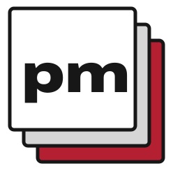

# pm-brand · Triplicate

The shared identity for pm surfaces: form paper, carbon ink, three stacked sheets,
and violet stamp ink. [The contract](CONTRACT.md) defines every token and type role.

**Release held: depend on an exact commit until the first release.**

```json
{ "dependencies": { "pm-brand": "github:unbraind/pm-brand#<40-character-commit>" } }
```



```css
@import "pm-brand/tokens.css";
@import "pm-brand/fonts.css";

body { background: var(--pm-paper); color: var(--pm-carbon); font-family: var(--pm-font-body); }
h1 { font-family: var(--pm-font-display); font-stretch: 125%; font-weight: 800; }
```

```ts
import { tokens, cssVar } from 'pm-brand';
const paper = tokens.light.paper;
const background = cssVar('paper'); // var(--pm-paper)
```

Set `data-theme="light"` or `data-theme="dark"` on the root for an explicit
choice; otherwise the OS preference applies. Reduced motion sets `--pm-dur` to zero.

Archivo supplies display (125% / 800) and caption (75% / 600) roles. Public Sans
is the body face; Martian Mono is for ids, commands and TOON. Importing fonts.css
loads only relative, self-hosted WOFF2 assets with swap and measured fallback faces.
See [font sources, metrics and subset details](fonts/SOURCES.md) and [OFL licences](fonts/OFL.txt).

The package exports `tokens.css`, `fonts.css`, `fonts/*`, `logo/*`, `icons/*`,
`CONTRACT.md` and `package.json`. The root exports typed values for both themes
and `cssVar`. All SVG marks and product lockups contain glyph paths, so no font
needs to be available to display them. Icons include a maskable safe-zone variant.

Rebuild fonts with fontTools 4.65.0 and brotli 1.2.0 installed, then
`npm run fonts:build` and `npm run assets:build`. `npm run font-budget` enforces
120,000 bytes across the three WOFF2 files. No release is authorized by these commands.
