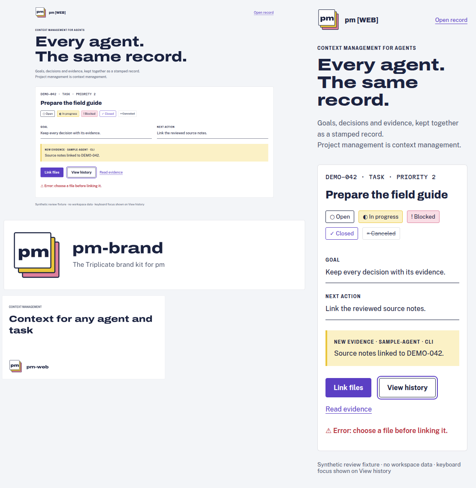
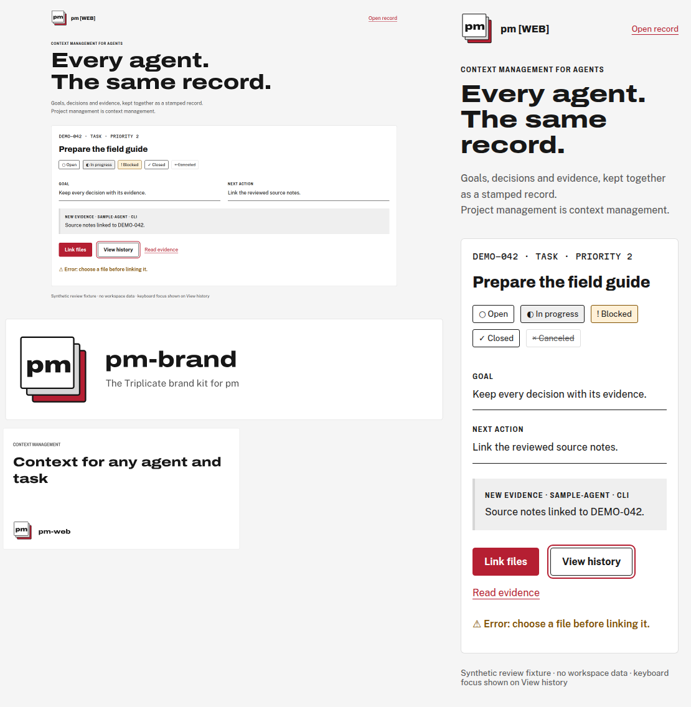
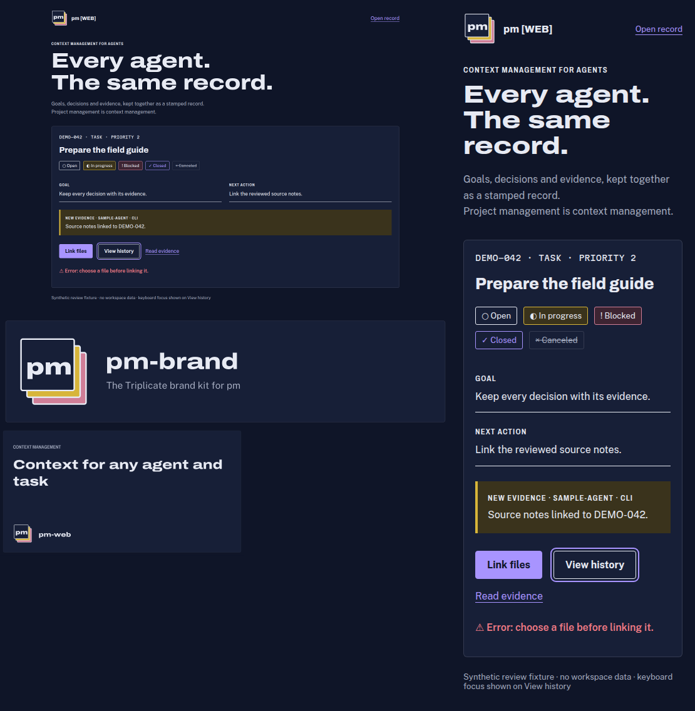
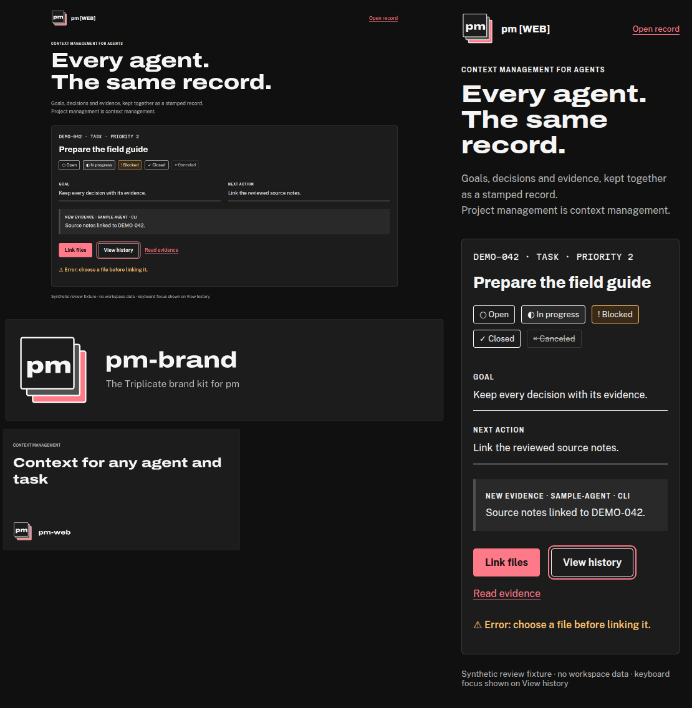
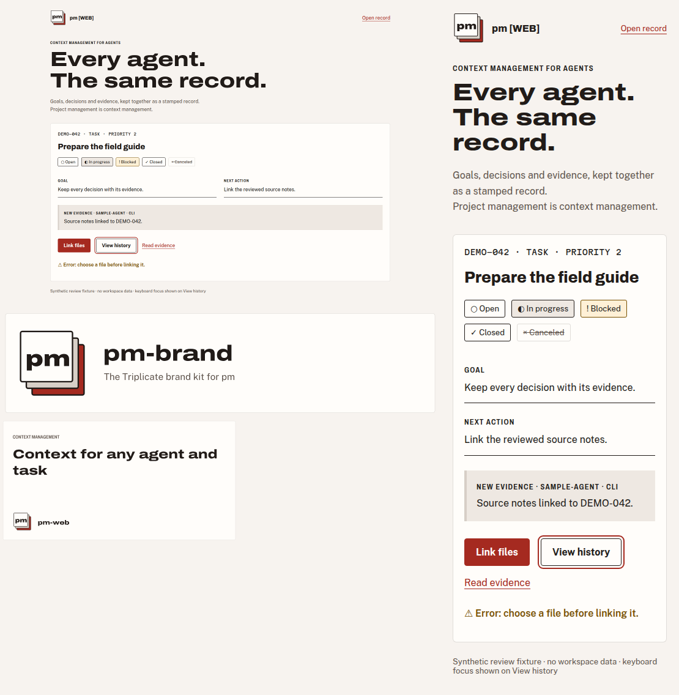
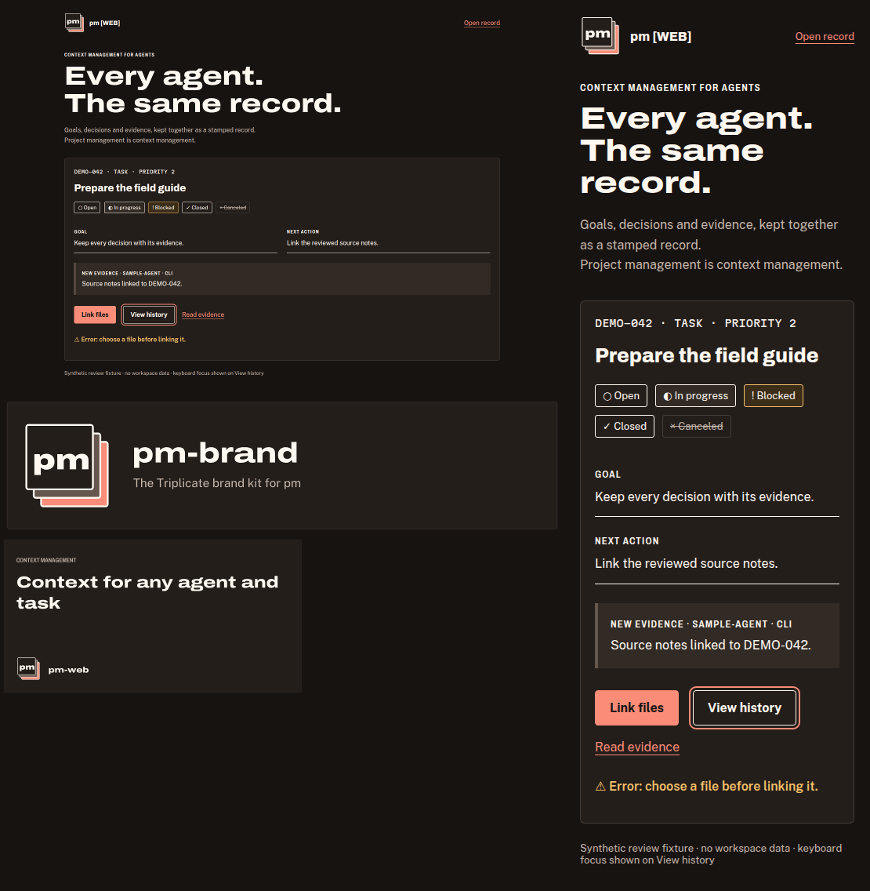

# Triplicate palette review · issue #9

**Draft: owner selection pending.** Signal is implemented on this branch for comparison;
no identity is final, no consumer has been rolled out, and release remains held.
The two candidates retain the three-sheet mark, font files, type scale, radii,
image generator APIs, path lettering and composition. Only palette values change.

The package had no app/homepage page. [The synthetic package sample](../samples/app.html)
uses the existing CONTRACT.md sheet, strip, field, copy-slip and action grammar.
Its composition is identical for before and both candidates; these are package
review fixtures, not screenshots or acceptance of downstream products.
The README banner and OG use the existing banner()/ogImage() output, recoloured
by exact palette substitution for alternatives. The Signal banner/OG use the
actual canonical output without substitutions. All content is synthetic.

## Recommendation

**Signal** puts neutral white, black and red at the centre of the family. Neutral
copy sheets preserve the Triplicate silhouette without retaining the old blue/violet
cast. Red identifies actions and the third copy; amber identifies errors and blocked
work. Closed is carbon ink, so completion does not look like an error or a red action.
Oxide offers a warmer paper and deeper red at the same contrast thresholds.
Neither option changes typography, mark geometry, layout or motion.

## Before / after

Overview sheets include desktop and 390 px app, desktop banner and 390 px OG.
Images below link to full-size files. The detailed gallery links every asset at
1440, 768 and 390 CSS px, device scale 1. Banner and OG preserve their native aspect
ratios and scale to viewport width: the 390 px views intentionally show their
real thumbnail size, rather than an invented mobile composition.

### Signal (recommended)

Neutral white/black surfaces and crisp red retain the form-paper character and give the clearest Unbrained family resemblance.

| Theme | Before | Signal (recommended) |
|---|---|---|
| light |  |  |
| dark |  |  |

| Theme / asset | 1440 px | 768 px | 390 px |
|---|---|---|---|
| light app | [before](before-light-app-1440.png) · [after](signal-light-app-1440.png) | [before](before-light-app-768.png) · [after](signal-light-app-768.png) | [before](before-light-app-390.png) · [after](signal-light-app-390.png) |
| light banner | [before](before-light-banner-1440.png) · [after](signal-light-banner-1440.png) | [before](before-light-banner-768.png) · [after](signal-light-banner-768.png) | [before](before-light-banner-390.png) · [after](signal-light-banner-390.png) |
| light og | [before](before-light-og-1440.png) · [after](signal-light-og-1440.png) | [before](before-light-og-768.png) · [after](signal-light-og-768.png) | [before](before-light-og-390.png) · [after](signal-light-og-390.png) |
| dark app | [before](before-dark-app-1440.png) · [after](signal-dark-app-1440.png) | [before](before-dark-app-768.png) · [after](signal-dark-app-768.png) | [before](before-dark-app-390.png) · [after](signal-dark-app-390.png) |
| dark banner | [before](before-dark-banner-1440.png) · [after](signal-dark-banner-1440.png) | [before](before-dark-banner-768.png) · [after](signal-dark-banner-768.png) | [before](before-dark-banner-390.png) · [after](signal-dark-banner-390.png) |
| dark og | [before](before-dark-og-1440.png) · [after](signal-dark-og-1440.png) | [before](before-dark-og-768.png) · [after](signal-dark-og-768.png) | [before](before-dark-og-390.png) · [after](signal-dark-og-390.png) |

#### Semantic token values

Values shown resolved; CSS/TypeScript status tokens keep their references. Fonts, scale,
shape and motion are identical to the baseline.

| Token | Light | Dark |
|---|---|---|
| `--pm-paper` | `#F5F5F5` | `#101010` |
| `--pm-sheet` | `#FFFFFF` | `#1C1C1C` |
| `--pm-carbon` | `#171717` | `#F5F5F5` |
| `--pm-graphite` | `#555555` | `#B5B5B5` |
| `--pm-rule` | `rgba(23, 23, 23, .14)` | `rgba(245, 245, 245, .14)` |
| `--pm-copy-secondary` | `#D6D6D6` | `#505050` |
| `--pm-copy-tertiary` | `#B51F32` | `#FF7A88` |
| `--pm-stamp` | `#B51F32` | `#FF7A88` |
| `--pm-stamp-wash` | `#FCECEE` | `#381C21` |
| `--pm-on-stamp` | `#FFFFFF` | `#101010` |
| `--pm-danger` | `#805000` | `#FFC46B` |
| `--pm-progress-wash` | `#EFEFEF` | `#292929` |
| `--pm-blocked-wash` | `#FFF0D6` | `#382A16` |
| `--pm-focus` | `2px solid var(--pm-stamp)` | `2px solid var(--pm-stamp)` |
| `--pm-focus-offset` | `3px` | `3px` |
| `--pm-status-open-fg` | `#171717` | `#F5F5F5` |
| `--pm-status-open-bg` | `#FFFFFF` | `#1C1C1C` |
| `--pm-status-open-border` | `#171717` | `#F5F5F5` |
| `--pm-status-in_progress-fg` | `#171717` | `#F5F5F5` |
| `--pm-status-in_progress-bg` | `#EFEFEF` | `#292929` |
| `--pm-status-in_progress-border` | `#171717` | `#F5F5F5` |
| `--pm-status-blocked-fg` | `#171717` | `#F5F5F5` |
| `--pm-status-blocked-bg` | `#FFF0D6` | `#382A16` |
| `--pm-status-blocked-border` | `#805000` | `#FFC46B` |
| `--pm-status-closed-fg` | `#171717` | `#F5F5F5` |
| `--pm-status-closed-bg` | `#FFFFFF` | `#1C1C1C` |
| `--pm-status-closed-border` | `#171717` | `#F5F5F5` |
| `--pm-status-canceled-fg` | `#555555` | `#B5B5B5` |
| `--pm-status-canceled-bg` | `transparent` | `transparent` |
| `--pm-status-canceled-border` | `rgba(23, 23, 23, .14)` | `rgba(245, 245, 245, .14)` |

Focus uses `2px solid var(--pm-stamp)` at a 3 px offset in both themes.

#### Measured contrast

36 text pairs ≥ 4.5:1; 10 focus pairs ≥ 3:1, including the three wash surfaces.
28 decorative border pairs have no required minimum because every status has
a visible label and symbol; canceled also has a line-through. Ratios below are
WCAG 2.x sRGB luminance ratios, rounded to three decimals only for presentation.
No rounded value is used for pass/fail.

| Pair | Use / minimum | Light | Dark |
|---|---|---:|---:|
| carbon / paper | text / 4.5 | 16.444 | 17.453 |
| carbon / sheet | text / 4.5 | 17.928 | 15.632 |
| graphite / paper | text / 4.5 | 6.838 | 9.280 |
| graphite / sheet | text / 4.5 | 7.455 | 8.311 |
| stamp / paper | text / 4.5 | 6.007 | 7.603 |
| stamp / sheet | text / 4.5 | 6.549 | 6.810 |
| danger / paper | text / 4.5 | 6.284 | 12.106 |
| danger / sheet | text / 4.5 | 6.851 | 10.842 |
| carbon / canary-wash | text / 4.5 | 15.591 | 13.344 |
| carbon / rose-wash | text / 4.5 | 15.953 | 12.748 |
| carbon / stamp-wash | text / 4.5 | 15.684 | 14.203 |
| on-stamp / stamp | text / 4.5 | 6.549 | 7.603 |
| status-open-fg / status-open-bg | text / 4.5 | 17.928 | 15.632 |
| status-open-border / status-open-bg | decorative / — | 17.928 | 15.632 |
| status-open-border / paper | decorative / — | 16.444 | 17.453 |
| status-open-border / sheet | decorative / — | 17.928 | 15.632 |
| status-in_progress-fg / status-in_progress-bg | text / 4.5 | 15.591 | 13.344 |
| status-in_progress-border / status-in_progress-bg | decorative / — | 15.591 | 13.344 |
| status-in_progress-border / paper | decorative / — | 16.444 | 17.453 |
| status-in_progress-border / sheet | decorative / — | 17.928 | 15.632 |
| status-blocked-fg / status-blocked-bg | text / 4.5 | 15.953 | 12.748 |
| status-blocked-border / status-blocked-bg | decorative / — | 6.096 | 8.842 |
| status-blocked-border / paper | decorative / — | 6.284 | 12.106 |
| status-blocked-border / sheet | decorative / — | 6.851 | 10.842 |
| status-closed-fg / status-closed-bg | text / 4.5 | 17.928 | 15.632 |
| status-closed-border / status-closed-bg | decorative / — | 17.928 | 15.632 |
| status-closed-border / paper | decorative / — | 16.444 | 17.453 |
| status-closed-border / sheet | decorative / — | 17.928 | 15.632 |
| status-canceled-fg / paper | text / 4.5 | 6.838 | 9.280 |
| status-canceled-border / paper | decorative / — | 1.334 | 1.443 |
| status-canceled-fg / sheet | text / 4.5 | 7.455 | 8.311 |
| status-canceled-border / sheet | decorative / — | 1.339 | 1.507 |
| stamp / paper | focus / 3 | 6.007 | 7.603 |
| stamp / sheet | focus / 3 | 6.549 | 6.810 |
| stamp / stamp-wash | focus / 3 | 5.729 | 6.187 |
| stamp / canary-wash | focus / 3 | 5.695 | 5.813 |
| stamp / rose-wash | focus / 3 | 5.827 | 5.554 |

### Oxide

Warmer white and charcoal with deeper red soften the paper while retaining the same mark, type and composition.

| Theme | Before | Oxide |
|---|---|---|
| light |  |  |
| dark |  |  |

| Theme / asset | 1440 px | 768 px | 390 px |
|---|---|---|---|
| light app | [before](before-light-app-1440.png) · [after](oxide-light-app-1440.png) | [before](before-light-app-768.png) · [after](oxide-light-app-768.png) | [before](before-light-app-390.png) · [after](oxide-light-app-390.png) |
| light banner | [before](before-light-banner-1440.png) · [after](oxide-light-banner-1440.png) | [before](before-light-banner-768.png) · [after](oxide-light-banner-768.png) | [before](before-light-banner-390.png) · [after](oxide-light-banner-390.png) |
| light og | [before](before-light-og-1440.png) · [after](oxide-light-og-1440.png) | [before](before-light-og-768.png) · [after](oxide-light-og-768.png) | [before](before-light-og-390.png) · [after](oxide-light-og-390.png) |
| dark app | [before](before-dark-app-1440.png) · [after](oxide-dark-app-1440.png) | [before](before-dark-app-768.png) · [after](oxide-dark-app-768.png) | [before](before-dark-app-390.png) · [after](oxide-dark-app-390.png) |
| dark banner | [before](before-dark-banner-1440.png) · [after](oxide-dark-banner-1440.png) | [before](before-dark-banner-768.png) · [after](oxide-dark-banner-768.png) | [before](before-dark-banner-390.png) · [after](oxide-dark-banner-390.png) |
| dark og | [before](before-dark-og-1440.png) · [after](oxide-dark-og-1440.png) | [before](before-dark-og-768.png) · [after](oxide-dark-og-768.png) | [before](before-dark-og-390.png) · [after](oxide-dark-og-390.png) |

#### Semantic token values

Values shown resolved; CSS/TypeScript status tokens keep their references. Fonts, scale,
shape and motion are identical to the baseline.

| Token | Light | Dark |
|---|---|---|
| `--pm-paper` | `#F7F3EF` | `#171311` |
| `--pm-sheet` | `#FFFDFA` | `#241E1A` |
| `--pm-carbon` | `#211B18` | `#FFF8F0` |
| `--pm-graphite` | `#60554D` | `#C4B6AA` |
| `--pm-rule` | `rgba(33, 27, 24, .14)` | `rgba(255, 248, 240, .14)` |
| `--pm-copy-secondary` | `#D7CFC7` | `#65574D` |
| `--pm-copy-tertiary` | `#A52A20` | `#FA8C78` |
| `--pm-stamp` | `#A52A20` | `#FA8C78` |
| `--pm-stamp-wash` | `#FAEAE5` | `#40251F` |
| `--pm-on-stamp` | `#FFFFFF` | `#171311` |
| `--pm-danger` | `#785000` | `#F5C06A` |
| `--pm-progress-wash` | `#EEE8E2` | `#322A24` |
| `--pm-blocked-wash` | `#FFF0D6` | `#3B2D18` |
| `--pm-focus` | `2px solid var(--pm-stamp)` | `2px solid var(--pm-stamp)` |
| `--pm-focus-offset` | `3px` | `3px` |
| `--pm-status-open-fg` | `#211B18` | `#FFF8F0` |
| `--pm-status-open-bg` | `#FFFDFA` | `#241E1A` |
| `--pm-status-open-border` | `#211B18` | `#FFF8F0` |
| `--pm-status-in_progress-fg` | `#211B18` | `#FFF8F0` |
| `--pm-status-in_progress-bg` | `#EEE8E2` | `#322A24` |
| `--pm-status-in_progress-border` | `#211B18` | `#FFF8F0` |
| `--pm-status-blocked-fg` | `#211B18` | `#FFF8F0` |
| `--pm-status-blocked-bg` | `#FFF0D6` | `#3B2D18` |
| `--pm-status-blocked-border` | `#785000` | `#F5C06A` |
| `--pm-status-closed-fg` | `#211B18` | `#FFF8F0` |
| `--pm-status-closed-bg` | `#FFFDFA` | `#241E1A` |
| `--pm-status-closed-border` | `#211B18` | `#FFF8F0` |
| `--pm-status-canceled-fg` | `#60554D` | `#C4B6AA` |
| `--pm-status-canceled-bg` | `transparent` | `transparent` |
| `--pm-status-canceled-border` | `rgba(33, 27, 24, .14)` | `rgba(255, 248, 240, .14)` |

Focus uses `2px solid var(--pm-stamp)` at a 3 px offset in both themes.

#### Measured contrast

36 text pairs ≥ 4.5:1; 10 focus pairs ≥ 3:1, including the three wash surfaces.
28 decorative border pairs have no required minimum because every status has
a visible label and symbol; canceled also has a line-through. Ratios below are
WCAG 2.x sRGB luminance ratios, rounded to three decimals only for presentation.
No rounded value is used for pass/fail.

| Pair | Use / minimum | Light | Dark |
|---|---|---:|---:|
| carbon / paper | text / 4.5 | 15.407 | 17.525 |
| carbon / sheet | text / 4.5 | 16.752 | 15.629 |
| graphite / paper | text / 4.5 | 6.550 | 9.334 |
| graphite / sheet | text / 4.5 | 7.122 | 8.324 |
| stamp / paper | text / 4.5 | 6.444 | 7.988 |
| stamp / sheet | text / 4.5 | 7.006 | 7.124 |
| danger / paper | text / 4.5 | 6.457 | 11.102 |
| danger / sheet | text / 4.5 | 7.020 | 9.901 |
| carbon / canary-wash | text / 4.5 | 13.993 | 13.360 |
| carbon / rose-wash | text / 4.5 | 15.136 | 12.663 |
| carbon / stamp-wash | text / 4.5 | 14.551 | 13.270 |
| on-stamp / stamp | text / 4.5 | 7.114 | 7.988 |
| status-open-fg / status-open-bg | text / 4.5 | 16.752 | 15.629 |
| status-open-border / status-open-bg | decorative / — | 16.752 | 15.629 |
| status-open-border / paper | decorative / — | 15.407 | 17.525 |
| status-open-border / sheet | decorative / — | 16.752 | 15.629 |
| status-in_progress-fg / status-in_progress-bg | text / 4.5 | 13.993 | 13.360 |
| status-in_progress-border / status-in_progress-bg | decorative / — | 13.993 | 13.360 |
| status-in_progress-border / paper | decorative / — | 15.407 | 17.525 |
| status-in_progress-border / sheet | decorative / — | 16.752 | 15.629 |
| status-blocked-fg / status-blocked-bg | text / 4.5 | 15.136 | 12.663 |
| status-blocked-border / status-blocked-bg | decorative / — | 6.343 | 8.022 |
| status-blocked-border / paper | decorative / — | 6.457 | 11.102 |
| status-blocked-border / sheet | decorative / — | 7.020 | 9.901 |
| status-closed-fg / status-closed-bg | text / 4.5 | 16.752 | 15.629 |
| status-closed-border / status-closed-bg | decorative / — | 16.752 | 15.629 |
| status-closed-border / paper | decorative / — | 15.407 | 17.525 |
| status-closed-border / sheet | decorative / — | 16.752 | 15.629 |
| status-canceled-fg / paper | text / 4.5 | 6.550 | 9.334 |
| status-canceled-border / paper | decorative / — | 1.324 | 1.479 |
| status-canceled-fg / sheet | text / 4.5 | 7.122 | 8.324 |
| status-canceled-border / sheet | decorative / — | 1.329 | 1.529 |
| stamp / paper | focus / 3 | 6.444 | 7.988 |
| stamp / sheet | focus / 3 | 7.006 | 7.124 |
| stamp / stamp-wash | focus / 3 | 6.086 | 6.048 |
| stamp / canary-wash | focus / 3 | 5.853 | 6.089 |
| stamp / rose-wash | focus / 3 | 6.330 | 5.771 |

## Status and error reading without colour

The fixture labels all five states (Open, In progress, Blocked, Closed, Canceled)
and adds distinct symbols. Canceled is struck through. An outlined secondary
button visibly demonstrates keyboard focus. The primary button says “Link files”;
the amber alert begins with a warning symbol and “Error:” plus a recovery action.
Consumers must retain these labels, warning shapes and destructive action wording;
colour alone never communicates state, selection, error or danger. Amber is reserved
for blocked/destructive/error meaning, not a second brand accent. The contract's
existing stamp-wash remains a background for carbon text, never a stamp-text surface.

## Migration and compatibility

See [consumer migration notes](../palette-migration.md). No token or export is removed.
Four legacy copy names remain aliases for at least one release; status names and
banner/OG signatures are unchanged. CSS is generated from src/tokens.ts; do not fork
colours into a consuming app. Both automatic and explicit dark modes retain the
same tokens and reduced-motion behaviour.

## Reproduction and evidence

Run npm run build, npm run tokens:build, npm run assets:build, npm run banners:build,
then node scripts/palette-previews.ts and node scripts/palette-report.ts. The optional
review renderer requires an installed Playwright module and Chromium; select them
with PM_BRAND_PLAYWRIGHT_MODULE and PM_BRAND_CHROMIUM if they are outside the package.
No browser dependency ships to consumers. The renderer waits for document.fonts.ready,
rejects horizontal overflow and HTTP(S) resources, verifies all six core computed
app colours and three loaded brand font families, and captures device scale 1.
[Browser checks](browser-checks.json) record the Chromium version and all 54 captures;
[render receipts](render-receipts.json) index the source/theme/asset/viewport matrix.
[Raw contrast values](contrast.json) retain unrounded evidence for both candidates.
PNG files use the browser/resvg lossless compression; no lossy text compression.
Baseline token values are frozen in baseline-tokens.json for reproducibility.
The banner/OG snapshot hashes change intentionally with the reviewed palette;
geometry/path checks and clean-generation gates remain in force.

Owner review of the candidate remains outstanding. Technical checks and agent visual
inspection do not constitute the owner's design approval.
